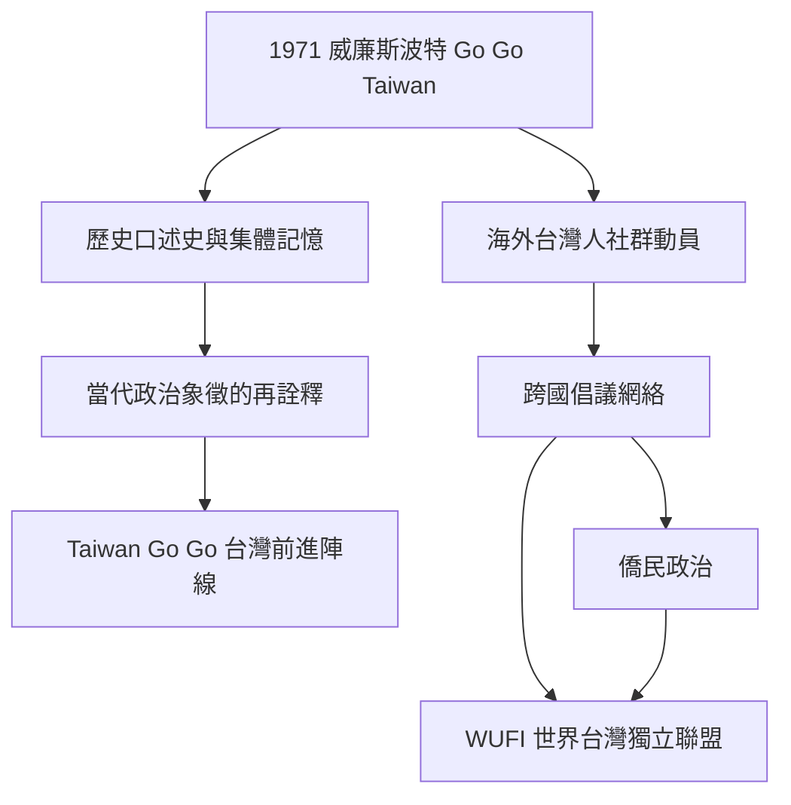

Taiwan Go Go的歷史線索，從1971年威廉斯波特事件連到1970年代海外台灣人組織，再連到當代聯盟對歷史象徵的重新使用。這張圖特別區分口號、歷史組織與當代政治陣線，避免誤認為組織延續。

相關概念可從[[term/僑民政治讓離散社群持續參與原居地公共事務]]、[[term/跨國倡議網絡讓不同國家的公民團體共同推動議題]]與[[term/台灣前進陣線是四個政黨與無黨籍夥伴的合作聯盟]]交叉閱讀。

## 思與行
- 補入日本、加拿大、歐洲與南美洲海外組織的個別口述史，讓網絡不是只以美國經驗代表。
- 以來源類型標示不同記憶：當事人口述、組織紀錄、新聞報導與學術研究。

## 參考
- [[data/威廉斯波特少棒賽場上的Go Go Taiwan飛機布條口述史]]。
- [[data/海外台灣人以跨國組織串連獨立運動的歷史資料]]。
- [[note/Go Go Taiwan的歷史記憶把海外抗爭與當代小黨合作連在一起]]。
