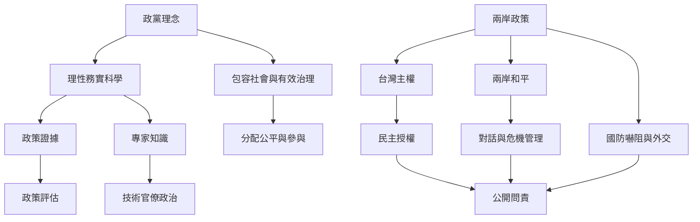

本圖將政黨的價值語言、政策工具與外部限制分開。民眾黨自我定位中的「理性、務實、科學」需要落實到政策評估；兩岸政策中的「台灣主權、兩岸和平」則需同時處理外交、國防、民主授權及對方反應。

搭配[[政策專業不能取代價值選擇與民主問責]]、[[兩岸和平與台灣主權是需要制度化處理的雙重目標]]、[[民眾黨2023年政綱以台灣主權與兩岸和平描述兩岸政策]]及[[民眾黨2026地方選舉共同政見以四大願景與九項政策作為架構]]。

## 參考
* 官方資料：[[民眾黨以理性務實科學與包容治理作為官方自我定位]]、[[民眾黨2023年外交政策主張以共同利益拓展國際連結]]。

回到全書：[[Taiwan_People's_Party]]。
