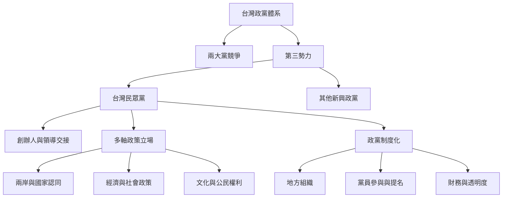

本圖把民眾黨放入台灣政黨體系與比較政治的分析框架。重點不是先替它貼上「中間」或「民粹」標籤，而是分開觀察它相對於兩大黨的位置、議題立場、選舉制度機會與組織持續性。

可沿著[[政黨體系]]、[[第三勢力]]、[[台灣民眾黨]]、[[個人化政黨]]、[[政黨制度化]]、[[民粹主義]]與[[政治光譜]]閱讀；也應搭配[[第三勢力不必然等於政治中間派]]、[[創辦人聲望可以帶來動員也可能延緩組織制度化]]與[[台灣政黨競爭存在多條議題軸線]]。

## 參考
* 比較背景：[[台灣政治體系研究提醒第三勢力仍受兩大黨結構與統獨裂縫影響]]。
* 研究支持：[[2025年台灣政黨相似性研究指出選民辨識政黨的軸線不只藍綠]]。

回到全書：[[Taiwan_People's_Party]]。
