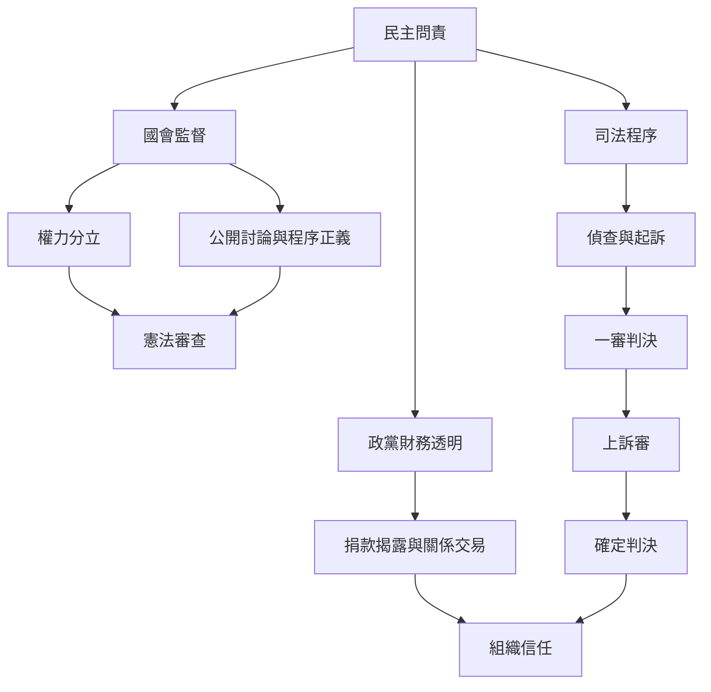

本圖整理民眾黨參與國會改革、司法案件與政治獻金爭議時應採取的分析流程。政黨責任不只看政策目標，也包括程序透明、財務治理與面對司法程序時對證據和法律階段的尊重。

閱讀[[監督權擴張必須同時接受程序正義與憲法審查]]、[[民主多數決不能免除公開討論與程序正義]]、[[政黨政治獻金透明度是組織信任的基礎]]與[[司法案件必須區分指控一審判決與確定判決]]。

## 參考
* 司法資料：[[憲法法庭113年憲判字第9號對2024國會改革部分規定作成違憲判斷]]、[[憲法訴訟法修正案在2025年遭憲法法庭認定立法程序重大瑕疵]]。
* 案件進度：[[截至2026年11月10日京華城案已進入二審準備程序柯文哲預定11月16日出庭]]。

回到全書：[[Taiwan_People's_Party]]。
