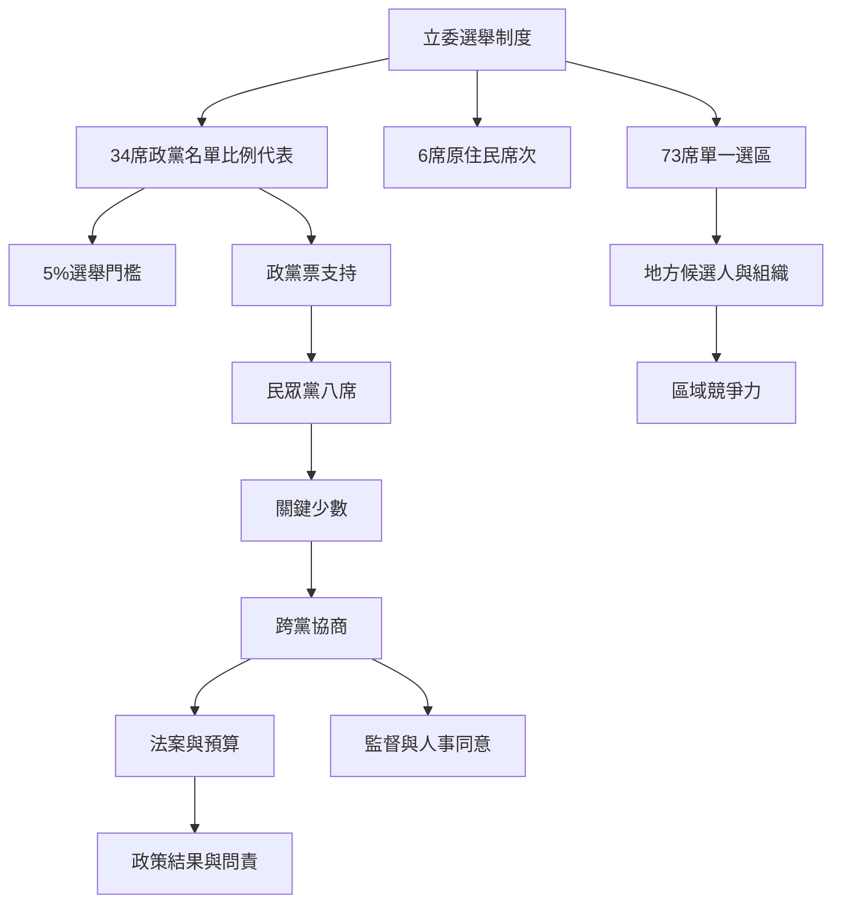

本圖說明政黨在選制中的入口如何影響其國會角色。民眾黨在區域席次與政黨票上的表現不同，2024 年後八席成為分立國會的重要協商力量；但影響力是否轉化為治理成果，仍要觀察每一項議案與程序。

連結[[混合選制]]、[[政黨名單比例代表制]]、[[選舉門檻]]、[[分立政府]]與[[半總統制]]；主要分析卡片為[[政黨票與區域席次衡量的是不同競爭能力]]、[[八席關鍵少數使議題協商比固定陣營更重要]]及[[分立政府的治理品質取決於跨黨協商規則]]。

## 參考
* 制度來源：[[台灣立委選制以單一選區與政黨名單並行影響小黨生存]]。
* 選後分析：[[2024年選後八席民眾黨在分立國會具有議事協商槓桿]]。

回到全書：[[Taiwan_People's_Party]]。
