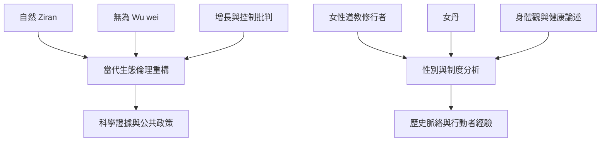

道家概念能啟發人重新思考控制、欲望、自然與差異，但當代應用必須經過批判重構。生態倫理需要避免把古代思想直接等同現代環保政策；性別研究則需同時呈現女性修行者的歷史能動性與身體規訓。兩者都提醒讀者：概念具有啟發力，但不能脫離歷史、制度與權力關係。

## 思與行
* 對道家生態主張，同時閱讀哲學論文與環境科學／政策研究。
* 對女性修煉史，將人物、文本、制度與身體論述並列，不以一種立場覆蓋複雜經驗。

## 參考
* [[道家生態倫理需要經過當代重構與實證檢驗]]。
* [[女性道教修行者的歷史能動性需要與性別限制一起分析]]。
* [[道家生態倫理是可供當代重構的資源而不是古代環保主義的同義詞]]。
* 全書導讀：[[Taoism]]。
