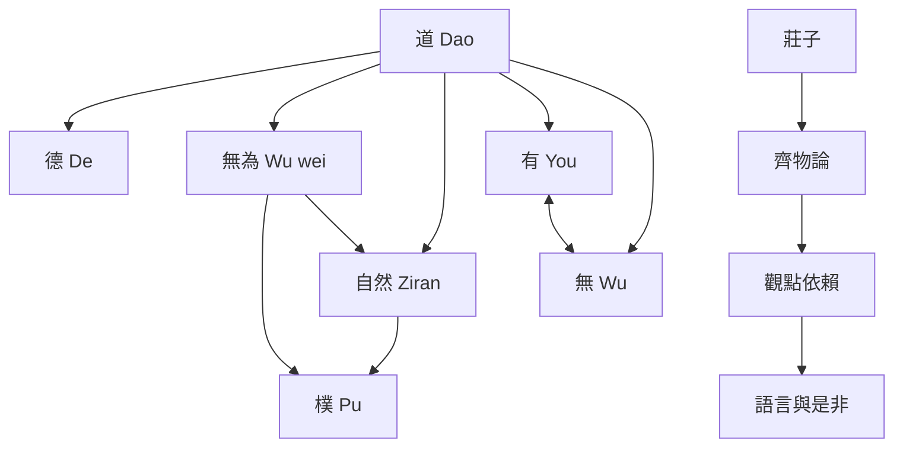

道家哲學不宜被整理成彼此孤立的格言，而應視為一組互相關聯的概念：道指向生成與道路，德描述生命展現的力量；無為與自然說明行動如何避免強制；樸提示過度加工的風險；有與無則讓人重新思考存在與作用的關係。《莊子》進一步把這些問題帶入語言、判斷與觀點轉換。

## 思與行
* 先從[[道 (Dao) 是萬物生成與行動可循的道路與關係脈絡]]開始，再讀[[德 (De) 是生命承接並展現道的具體力量]]、[[無為 (Wu wei) 是不強制而順應情勢的行動方式]]與[[自然而然 (Ziran) 指事物由自身如此發展而非任意放任]]。
* 以[[莊子 (Zhuangzi) 以寓言與觀點轉換鬆動僵固的判斷]]與[[齊物 (Qiwulun) 是莊子用來鬆動是非對立的觀點練習]]檢查自己如何使用分類與判斷。

## 參考
* [[道不是可被物化的神祕物質而是理解生成與行動的根本脈絡]]。
* [[無為不是消極不作為而是不強制的恰當介入]]。
* [[觀點依賴要求謙遜而不是放棄判斷]]。
* 全書導讀：[[Taoism]]。
