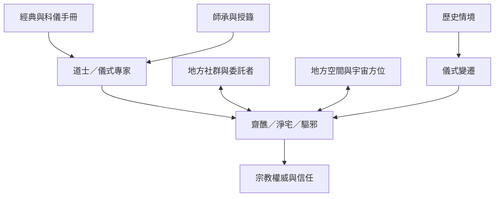

道教儀式把經典、神聖秩序與地方生活連起來。主持者的專業權威來自師承、技藝、儀式正確性與信眾關係；儀式本身則因地區與歷史條件不斷調整。從台灣的淨宅與醮典案例，可以看見道教科儀與地方信仰並非兩個互斥世界，而是在實際活動中彼此協商。

## 思與行
* 以[[齋醮 (Jiao) 是道教為社群舉行的公共祭儀]]與[[齋醮科儀 (Daoist Liturgy) 是以程序化行動連結人神與社群秩序]]理解儀式，再閱讀台灣田野材料。
* 觀察宗教專業時，結合[[傳承 (Lineage) 是知識與實踐透過師徒關係延續的制度]]與地方社會關係。

## 參考
* [[宗教儀式會把宇宙秩序轉化為地方可感的生活實踐]]。
* [[宗教權威是技藝與關係共同形成的社會成就]]。
* [[宗教傳承的延續仰賴持續的調整與重新制度化]]。
* 全書導讀：[[Taoism]]。
