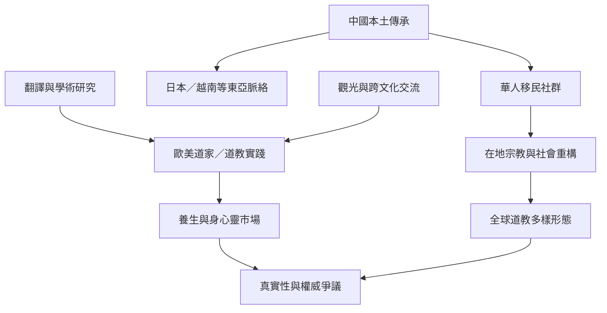

道教在現代世界的流動包含中國境內的城市化與制度調整、東亞文化元素的吸收、東南亞離散社群的再建構，以及歐美對氣、養生、哲學與靈性的重新詮釋。跨國流動帶來新的實踐與社群，也帶來真實性、商業化、文化挪用與歷史脈絡被抽離等爭議。

## 思與行
* 以區域案例比較傳播機制，不把不同地區都歸為「西方道教」或「海外華人道教」。
* 把[[傳統真實性必須透過具體傳承脈絡來討論]]當成研究問題，而非先驗答案。

## 參考
* [[道教的全球化不是單向輸出而是多方協商的再創造]]。
* [[新加坡華人社群把道教重新建構為跨殖民時代的倫理與文化資源]]。
* [[道教在日本留下的影響多以文化與宗教元素融入而非完整宗派移植]]。
* [[西方道教的流行形象常把中國宗教傳承改寫成個人化身心靈修]]。
* 全書導讀：[[Taoism]]。
