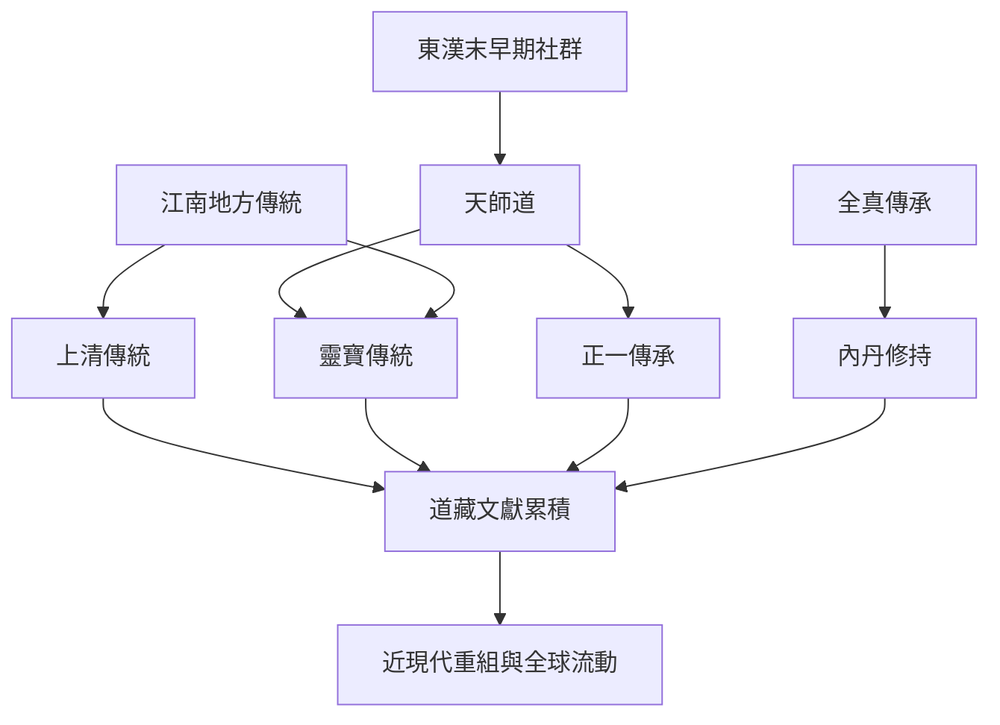

制度性道教的歷史不是由一位創始者建立後原樣延續，而是由不同時代的教團、啟示經典、儀式改革、修煉傳統與地方社群逐漸累積。天師道、上清與靈寶形成早期重要框架；後來正一與全真等傳承進一步發展。道藏則保存了多時代文本，但其編纂也反映選擇、分類與制度權力。

## 思與行
* 依序閱讀[[天師道 (Tianshi Dao) 是早期制度性道教的重要教團傳統]]、[[上清 (Shangqing) 是以啟示經典與內在觀想著稱的道教傳統]]、[[靈寶 (Lingbao) 是以齋醮儀式與宇宙救度為特色的道教傳統]]、[[正一 (Zhengyi) 是延續天師傳統的重要道教傳承]]與[[全真 (Quanzhen) 是重視出家修持與內丹的道教傳承]]。
* 再閱讀[[道藏 (Daozang) 是歷代道教文獻累積而成的經籍收藏]]，思考文獻保存與宗派正統的關係。

## 參考
* [[制度性道教由天師道起步並在後世形成多條經典與修行傳承]]。
* [[道教的多元傳承不應被單一正統敘事抹平]]。
* [[經典的權威是在傳承中被持續建構的]]。
* 全書導讀：[[Taoism]]。
