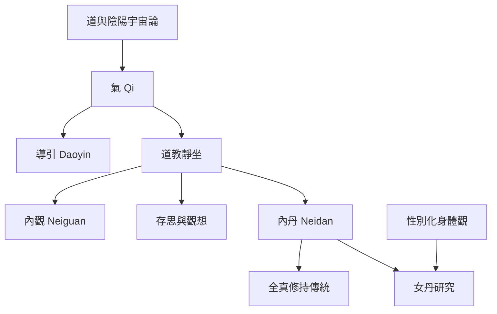

道教修煉把身體放在宇宙論與宗教目標之中理解。氣、陰陽與精氣神等語彙，在不同傳統中描述生命活動與轉化；靜坐包含守一、存思、內觀與內丹等路徑，導引則把動作與呼吸帶入身體實踐。這些路徑彼此有歷史交集，但不可當成同一種練習或直接套用現代醫療語言。

## 思與行
* 先讀[[氣 (Qi) 是中國思想中具有多重層次的生命與宇宙概念]]、[[陰陽 (Yin-yang) 是相互依存的差異性力量]]與[[導引 (Daoyin) 是以身體動作與呼吸調節為核心的傳統養生術]]。
* 再讀[[道教靜坐 (Daoist Meditation) 是多種歷史修持技術的總稱]]、[[內觀 (Neiguan) 是觀察身心內在變化的道教修持方法]]與[[內丹 (Neidan) 是以身體與宇宙轉化為框架的道教內修傳統]]。
* 以[[女性道教修行者 (Daoist Priestesses) 是道教制度史中不可忽略的行動者]]檢視身體理論中的性別差異。

## 參考
* [[道教內修是多種身體技術與宇宙論的歷史集合]]。
* [[道教靜坐包含多種歷史形態不能簡化成單一冥想技巧]]。
* [[女丹研究揭示修煉理想身體觀與女性健康論述彼此交纏]]。
* 全書導讀：[[Taoism]]。
