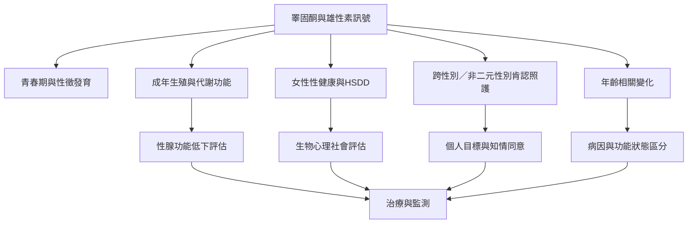

睪固酮在不同生命階段、身體條件與性別肯認目標下，可能具有不同意義。臨床治療不能只看激素數字，也需要考慮青春期與成年生殖功能、女性性健康、跨性別與非二元性別者的治療目標，以及老化相關健康狀況。

**延伸連結**：[[女性睪固酮治療的全球共識把適應症限縮於特定性慾困擾]]、[[女性低性慾困擾的睪固酮臨床指引強調整體評估與監測]]、[[跨性別男性化荷爾蒙照護需要依個人目標調整]]、[[跨性別健康照護標準第八版提供國際性照護框架]]、[[2026年跨性別男性婦科照護訪談指出制度性知識缺口]]。

**概念節點**：[[睪固酮（Testosterone）]]、[[低性慾困擾（HSDD）]]、[[性別肯認荷爾蒙治療（GAHT）]]、[[性腺功能低下（Hypogonadism）]]。

本書入口：[[Testosterone]]
