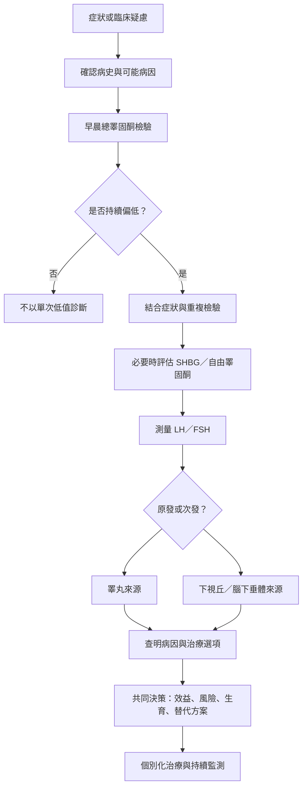

臨床決策的起點不是「想把睪固酮提高多少」，而是判斷是否存在符合症狀與檢驗的臨床症候群、病因位於哪個層級，以及治療是否符合當事人的目標。檢驗方法、採血時間、SHBG、生育計畫與監測負擔會共同影響決策。

**延伸連結**：[[低睪固酮診斷必須結合症狀與重複檢驗]]、[[原發性與次發性性腺功能低下需要不同的病因判讀]]、[[肥胖與疾病可能造成可逆的功能性低睪固酮]]、[[外源性睪固酮會抑制精子生成並影響生育計畫]]、[[睪固酮替代療法的安全性證據必須依研究族群解讀]]。

**概念節點**：[[性腺功能低下（Hypogonadism）]]、[[睪固酮替代療法（TRT）]]、[[自由睪固酮（Free testosterone）]]、[[性激素結合球蛋白（SHBG）]]、[[精子生成（Spermatogenesis）]]、[[紅血球增多症（Erythrocytosis）]]。

本書入口：[[Testosterone]]
