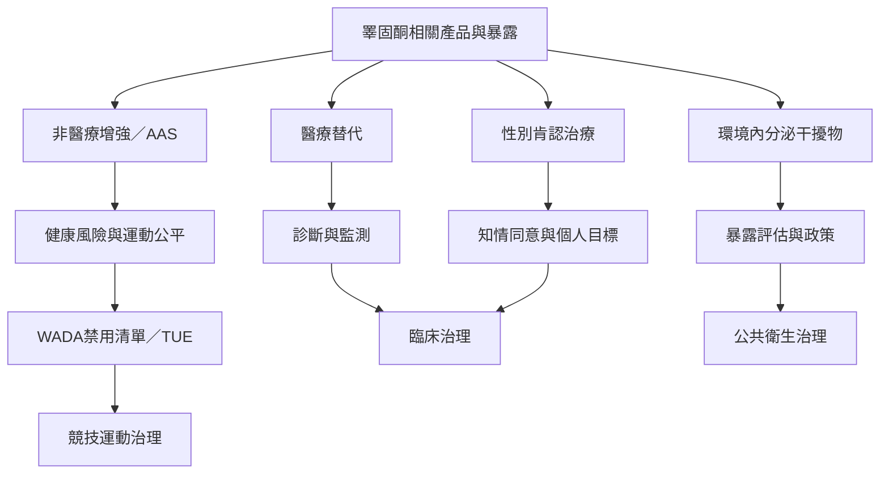

睪固酮同時涉及臨床治療、非醫療增強、競技運動、藥品監管與環境暴露。公共衛生分析需要把個人醫療決策與集體制度規範分開，辨識不同使用情境的利益、風險、權利與責任。

**延伸連結**：[[全球合成代謝雄性類固醇使用率存在顯著地區與樣本差異]]、[[世界反禁藥組織2026年禁用清單將睪固酮列為全年禁用的合成代謝類固醇]]、[[睪固酮以外的環境內分泌干擾物也會影響男性生殖健康]]、[[美國FDA於2026年更新睪固酮產品標示但未取消臨床評估需求]]。

**概念節點**：[[合成代謝雄性類固醇（AAS）]]、[[睪固酮替代療法（TRT）]]、[[性別肯認荷爾蒙治療（GAHT）]]、[[內分泌干擾物（Endocrine disruptor）]]、[[紅血球增多症（Erythrocytosis）]]。

本書入口：[[Testosterone]]
