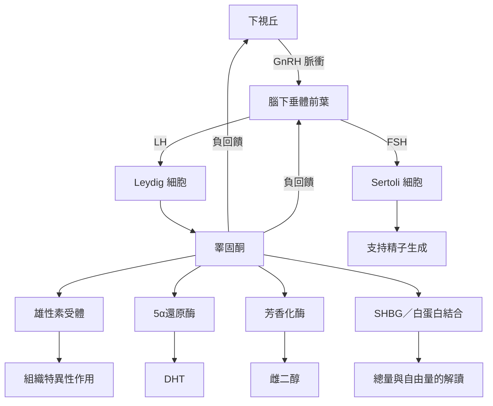

本圖由激素來源與回饋調節出發，連結結合蛋白、受體、代謝產物與生理效應。理解這張圖時，請將「血中濃度」與「組織作用」分開：同一濃度可能因 SHBG、受體表現、酵素活性及組織環境而產生不同效果。

**延伸連結**：[[睪固酮由下視丘—腦下垂體—性腺軸以脈衝方式調節]]、[[睪固酮透過雄性素受體與代謝產物共同作用]]、[[總睪固酮與自由睪固酮回答不同問題]]、[[睪固酮檢驗必須考慮時間與測量方法]]。

**概念節點**：[[睪固酮（Testosterone）]]、[[雄性素（Androgen）]]、[[下視丘腦下垂體性腺軸（HPG axis）]]、[[促性腺激素釋放激素（GnRH）]]、[[黃體生成素（LH）]]、[[濾泡刺激素（FSH）]]、[[萊氏細胞（Leydig cell）]]、[[支持細胞（Sertoli cell）]]、[[性激素結合球蛋白（SHBG）]]、[[自由睪固酮（Free testosterone）]]、[[二氫睪固酮（DHT）]]、[[芳香化酶（Aromatase）]]、[[雌二醇（Estradiol）]]、[[雄性素受體（Androgen receptor）]]。

本書入口：[[Testosterone]]
