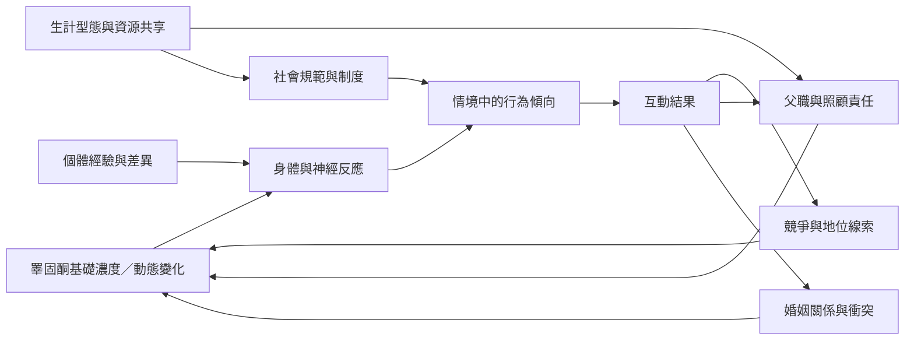

本圖把激素、行為與社會情境放在互相作用的關係中。基礎濃度不等於行為命令；競爭、威脅、婚姻衝突、照顧投入與資源分享都可能改變激素與行為的關係。跨文化田野研究的價值，在於檢驗某種關聯是否只存在於特定社會生態。

**延伸連結**：[[睪固酮與人類攻擊行為的關聯在統合分析中偏弱]]、[[坦尚尼亞哈扎族與達托加族研究顯示父職照顧會改變荷爾蒙關係]]、[[剛果盆地巴雅卡族研究把分享照顧與睪固酮放在同一脈絡中]]、[[跨文化比較能檢驗荷爾蒙理論的適用範圍]]。

**概念節點**：[[雄性素（Androgen）]]、[[睪固酮（Testosterone）]]、[[性別差異不能被單一荷爾蒙決定論取代]]。

本書入口：[[Testosterone]]
