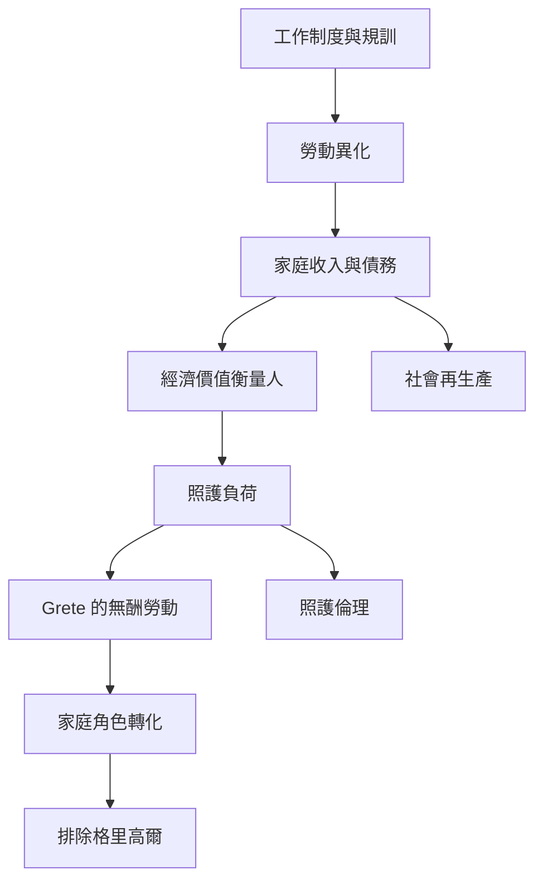

本概念地圖整理工作規訓、家庭債務、經濟價值、無酬照護與家庭成員變化。格里高爾失去收入後，家庭如何重新分配勞動與照護，是理解小說社會批判的關鍵。

## 雙向連結
* [[工作制度在格里高爾變形前已經侵入他的自我理解]]
* [[家庭債務讓親情成為交換關係]]
* [[經濟價值逐漸成為家人衡量格里高爾的尺度]]
* [[初期照護會被持續性照護負荷侵蝕]]
* [[Grete的照護勞動逐漸被視為理所當然]]
* [[Grete也經歷變形而不只是格里高爾的照護者]]
* [[勞動異化]]
* [[社會再生產]]
* [[照護倫理]]
