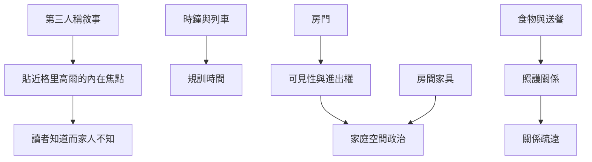

本概念地圖聚焦小說如何透過第三人稱焦點、房門、房間、時鐘與食物安排讀者的觀看位置。形式不是內容之外的包裝，而是讓權力、隔離與主體性變得可感的敘事裝置。

## 雙向連結
* [[故事以沒有解釋的變形開場使讀者先經驗而非解謎]]
* [[第三人稱敘事貼近格里高爾卻保留讀者的觀察距離]]
* [[門把與房門把家庭關係變成可見的空間規則]]
* [[房間與家具的變化呈現格里高爾的歸屬逐步被撤回]]
* [[食物的變化記錄格里高爾與家庭關係的變化]]
* [[敘事焦點]]
* [[規訓]]
* [[空間政治]]
