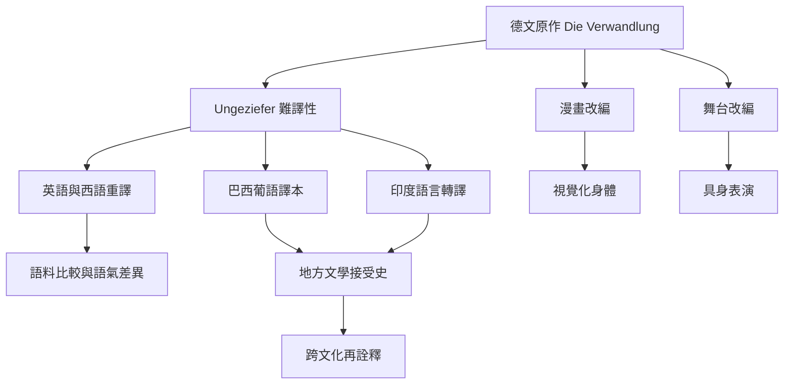

本概念地圖整理《變形記》如何在英語、西語、葡語、印度語言與不同媒介中被重新閱讀。翻譯與改編不是附屬於原作的補充，而是讓作品在新文化、新讀者與新形式中延續生命的詮釋活動。

## 雙向連結
* [[翻譯選詞會改變讀者想像的格里高爾身體]]
* [[跨文化接受史顯示作品意義會在翻譯與改編中再生]]
* [[舞台改編把抽象異化轉化為可觀看的身體與空間]]
* [[以多語改編展開一場全球卡夫卡對話]]
* [[文學翻譯]]
* [[改編研究]]
