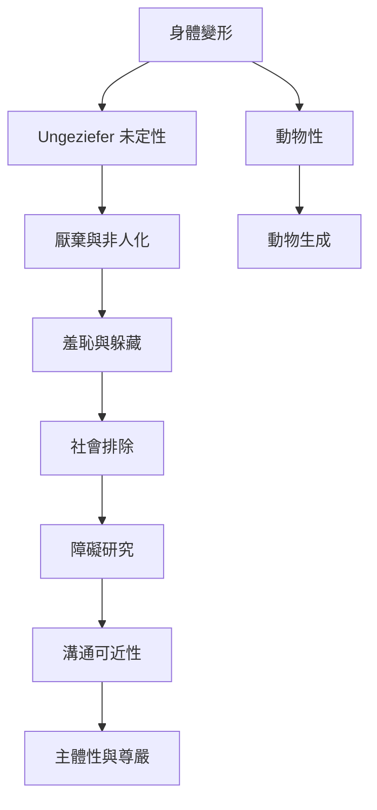

本概念地圖整理格里高爾身體變化如何牽動人／動物分類、厭棄、羞恥、障礙與溝通可近性。閱讀時應同時區分身體本身、他人的反應，以及制度如何把差異轉化為排除。

## 雙向連結
* [[未指明的昆蟲身分讓變形保持開放]]
* [[昆蟲身體挑戰人與動物邊界卻不取消格里高爾的主體性]]
* [[障礙研究把焦點從異常身體轉向排除制度]]
* [[厭惡感會讓讀者參與作品所揭露的排斥機制]]
* [[羞恥使格里高爾逐漸主動隱藏自己的身體]]
* [[格里高爾的內在感受持續存在但外界無法理解他的聲音]]
* [[Ungeziefer]]
* [[障礙研究]]
* [[厭棄]]
* [[動物性]]
* [[羞恥]]
