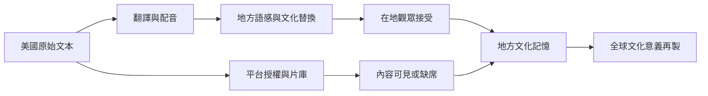

《辛普森家庭》的全球傳播不是單純出口一套固定文本。各地配音團隊、字幕譯者、電視台與串流平台共同決定觀眾聽見什麼、看見什麼，以及哪些內容被重新命名、替換或缺席。跨國比較應把文本、譯配、觀眾與平台放在同一條傳播鏈中。

## 關係圖

## 概念連結
* [[國際觀眾可能把美國動畫讀成對美國資本主義的自我諷刺]]
* [[義大利配音必須在美國文化典故與地方觀眾可理解性之間協商]]
* [[拉丁美洲配音團隊共同創造了具有地方辨識度的Springfield西班牙語]]
* [[法語配音會重新配置角色聲音所承載的階級與地域差異]]
* [[辛普森家庭描繪日本時常把日本文化轉化為美國流行文化的異國景觀]]
* [[香港Disney+未收錄天安門廣場相關集數顯示平台分發受政治環境制約]]
* [[英國觀眾把美國動畫進口品轉化為本地公共文化符號]]
* [[全球化流通不等於文化意義單向輸出]]
* [[文化翻譯不是把字詞換語言而是共同製造地方語感]]

## 延伸地圖
* [[諷刺如何從文本走入公共領域]]：地方觀眾如何重新理解節目的批判。
* [[角色再現粉絲參與與媒體產業如何互相回饋]]：跨國觀眾如何將批評帶回製作端。
