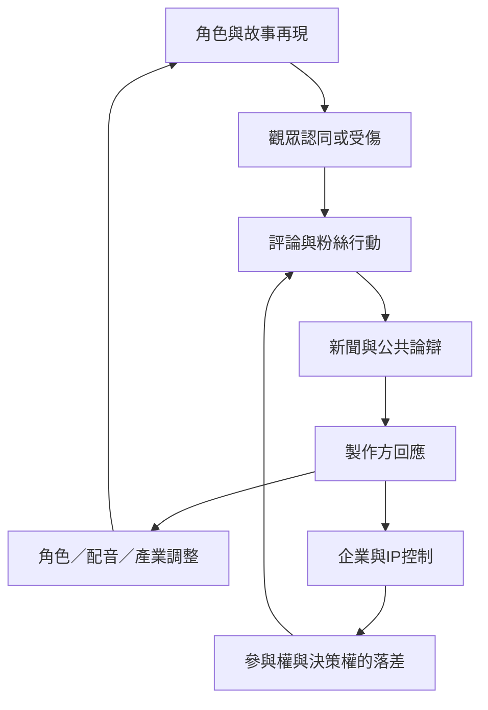

角色不只存在於故事中，也進入觀眾的日常生活、族群想像與產業工作分配。粉絲評論、迷因與行動可能改變作品的公共意義，但媒體公司仍保有智慧財產權與大部分決策權。Apu 爭議是理解這種回饋、問責與權力不對稱的重要案例。

## 關係圖

## 概念連結
* [[Apu爭議顯示喜劇角色的刻板形象會進入少數族裔的日常生活]]
* [[Apu配音者退出角色反映媒體產業開始回應代表性批評]]
* [[角色存在不等於群體獲得有尊嚴的再現]]
* [[批判代表性應從受眾受傷經驗回到產業權力結構]]
* [[粉絲 remix 與批評能回流原作但不代表粉絲擁有媒體決策權]]
* [[反主流文本仍可能成為主流媒體資產]]
* [[角色再現與刻板印象]]

## 延伸地圖
* [[諷刺如何從文本走入公共領域]]：幽默能否揭露再現背後的制度權力。
* [[全球流通如何透過翻譯與審查改變Springfield]]：不同地區的配音與觀眾如何加入文化回饋。
