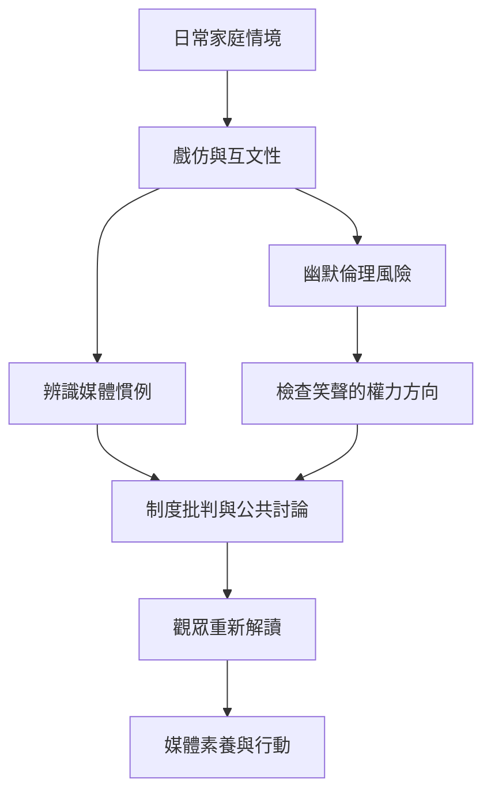

《辛普森家庭》的諷刺從角色與家庭情境出發，透過戲仿新聞、廣告、教育與宗教等媒體類型，使觀眾重新辨認制度的常識與權力。閱讀時應同時檢查笑話的批判方向，以及它是否複製了對弱勢群體的刻板化。

## 關係圖

## 概念連結
* [[諷刺的力量來自讓觀眾在笑聲中看見制度如何自我合理化]]
* [[諷刺透過戲仿家庭喜劇廣告與新聞讓觀眾重新解讀媒體類型]]
* [[辛普森家庭以幽默實踐對慣例的倫理說真話]]
* [[辛普森家庭以學校諷刺揭露新自由主義改革可能惡化公共教育]]
* [[Ned Flanders的諷刺同時嘲弄宗教政治並保留個人虔誠的道德價值]]
* [[媒體素養可以從辨認戲仿的目標開始]]
* [[幽默可以成為倫理說真話的形式但不保證它必然正當]]

## 延伸地圖
* [[全球流通如何透過翻譯與審查改變Springfield]]：諷刺進入不同文化與制度後如何變化。
* [[角色再現粉絲參與與媒體產業如何互相回饋]]：觀眾何時會支持、反對或改寫原作。
