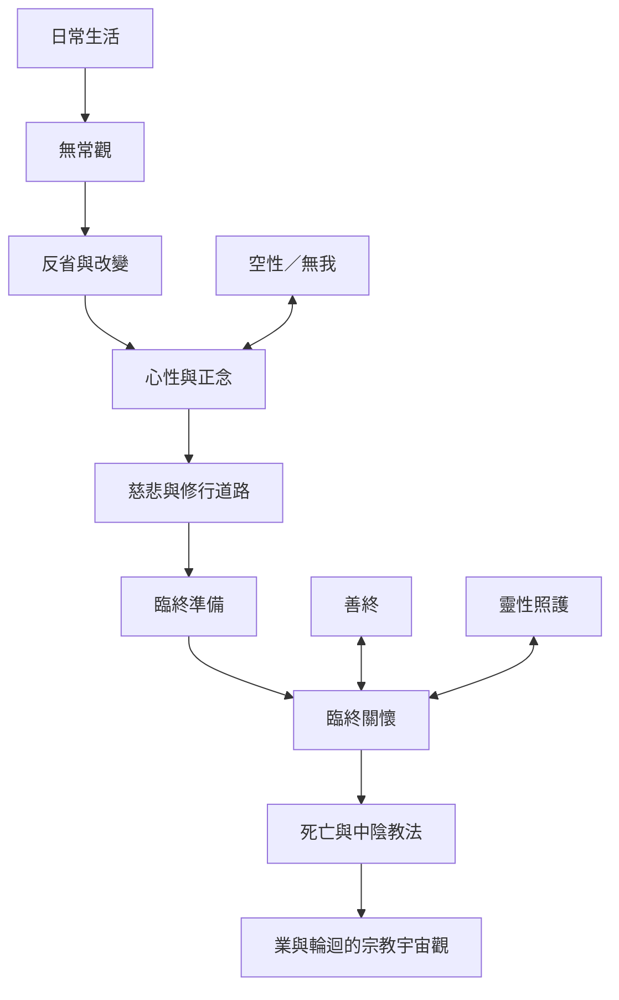

本圖以《西藏生死書》的主要閱讀順序為軸：從日常生命與無常觀，進入心性與修行，再連到臨終、死亡與中陰。它是閱讀導航，不代表所有佛教傳承都採取完全相同的分類。

閱讀這張圖時，可先把能落實於日常的修行與照護原則，和涉及死後心識及輪迴的教義分開。前者可透過實踐與臨床經驗持續檢討；後者則需要在藏傳佛教思想與傳承中理解。

## 概念連結
* [[無常]]、[[慈悲]]、[[中陰]]、[[業與輪迴]]、[[本覺光明]]、[[大圓滿]]。
* [[生命修持讓死亡準備不必等到臨終才開始]]、[[無常觀能幫助人重新配置時間與優先順序]]、[[善終品質不能只用延長生命衡量]]。
* [[每週一次無常練習把死亡反思轉成日常選擇]]。
* 本書導讀：[[The_Tibetan_Book_of_Living_and_Dying]]。
