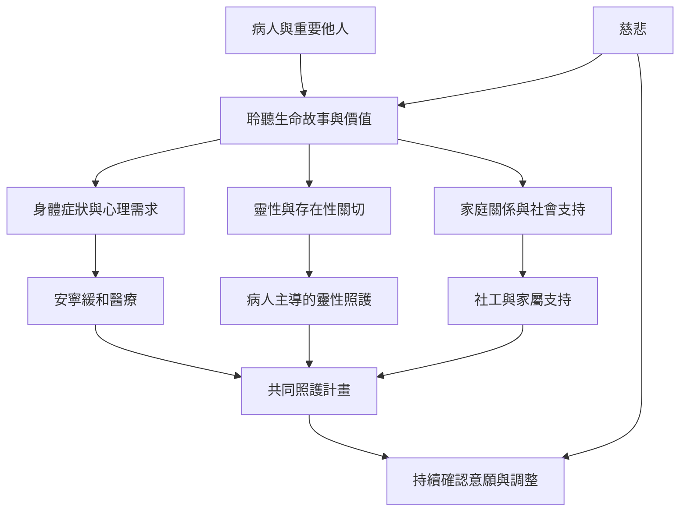

這張圖把宗教修行中的慈悲，轉成以病人為中心的跨專業照護流程：先理解個人價值，再評估身體與心理需要，確認靈性偏好，最後協調照護與支持。病人可選擇接受或不接受宗教資源。

實務上要避免將病人的宗教需求想像成固定答案。善終包括病人自身定義的目標，照護者則要清楚自身專業範圍，必要時轉介。

## 概念連結
* [[臨終關懷]]、[[安寧緩和醫療]]、[[善終]]、[[靈性照護]]、[[慈悲]]。
* [[陪伴臨終者首先是理解其價值與需要]]、[[靈性照護應從病人自己的價值與信念出發]]、[[照護者需要支持才能持續實踐慈悲]]。
* [[建立一套不預設宗教立場的臨終關懷對話卡]]、[[設計病人主導的靈性需求四問]]。
* 本書導讀：[[The_Tibetan_Book_of_Living_and_Dying]]。
