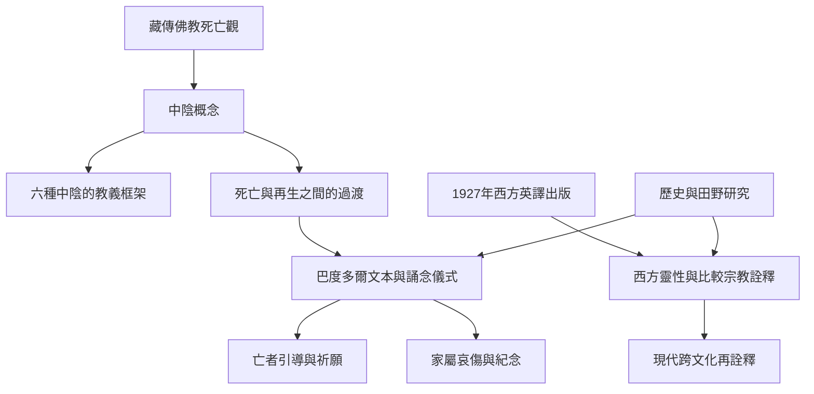

此圖把中陰教義、文本史、喪葬儀式與現代詮釋分開呈現。它提醒讀者，「中陰」是一個教義概念；《中陰聞教得度》是特定文本與儀式傳承；西方《西藏死者之書》則是翻譯出版史中的名稱。

圖中「死後旅程」與「心識延續」是宗教傳統中的理解；歷史研究可以考察文本形成與儀式實踐，社會科學可以研究這些信念如何影響生活，但兩者不等於對輪迴本身作出科學證明。

## 概念連結
* [[中陰]]、[[巴度多爾（Bardo Thödol）]]、[[本覺光明]]、[[業與輪迴]]。
* [[布萊恩庫埃瓦斯重建西藏死者之書的歷史脈絡]]、[[凱西肯普指出西藏死者之書在西方被重新建構]]。
* [[中陰聞教得度不是一本跨時代固定不變的單一文本]]、[[中陰儀式同時照顧亡者與生者]]。
* 本書導讀：[[The_Tibetan_Book_of_Living_and_Dying]]。
