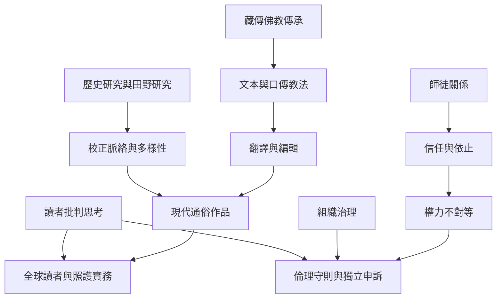

這張圖把宗教知識跨文化傳播與宗教組織倫理放在同一張圖中，提醒讀者：可讀性、傳統代表性、教師權威與組織安全是不同層次的問題，必須分別檢視。

翻譯的成功不等於原文化的完整代表；信仰上的敬意也不能替代組織問責。兩條線索應共同進入閱讀與實踐。

## 概念連結
* [[跨文化轉譯能讓古老教法進入現代生活也可能簡化脈絡]]。
* [[宗教導師的權威必須接受倫理與制度監督]]、[[信任與依止不能取代知情同意及退出自由]]。
* [[布萊恩庫埃瓦斯重建西藏死者之書的歷史脈絡]]、[[赫爾辛基藏傳佛教團體的師徒關係訪談研究]]、[[Rigpa獨立調查與英國慈善委員會確認的保護失靈]]。
* [[師徒關係]]、[[皈依]]、[[大圓滿]]。
* 本書導讀：[[The_Tibetan_Book_of_Living_and_Dying]]。
