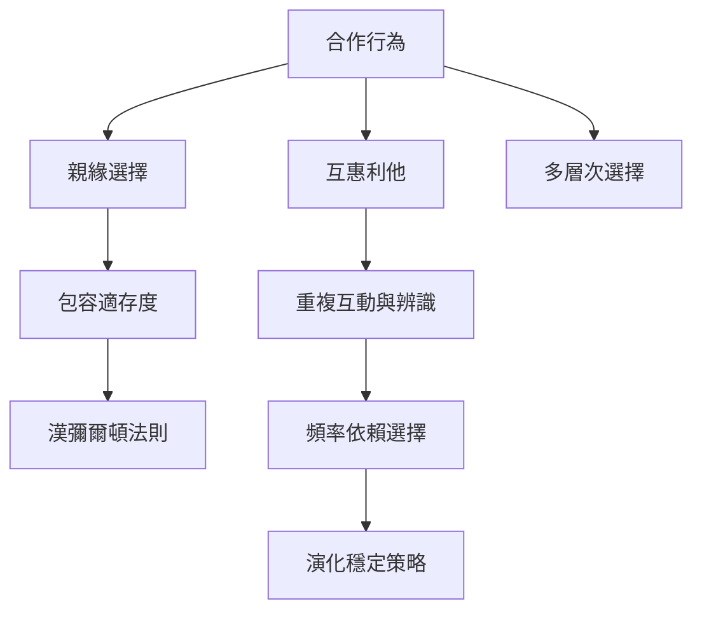

這張地圖整理《自私的基因》中「自私基因如何產生合作」的關鍵問題。親緣選擇與互惠利他是不同機制；演化穩定策略與頻率依賴選擇則用來分析策略互動與穩定條件。

核心概念：[[合作]]、[[親緣選擇]]、[[包容適存度]]、[[漢彌爾頓法則]]、[[互惠利他]]、[[演化穩定策略]]、[[頻率依賴選擇]]、[[多層次選擇]]。

永久筆記：[[包容適存度把自身繁殖與親屬效應納入同一計算]]、[[親緣選擇描述基因相似者之間的選擇效應]]、[[漢彌爾頓法則是有條件的成本效益判準]]、[[互惠利他需要重複互動與辨識不合作者的條件]]、[[演化穩定策略描述策略互動的抗入侵狀態]]、[[頻率依賴選擇使策略收益隨族群比例改變]]、[[合作不只是短期交換也可能創造新的個體層次]]。

靈感筆記：[[用同一個合作案例比較基因個體群體與生態層次]]、[[把合作的穩定性問題轉成社群設計問題]]、[[不要用基因演化替社會不平等提供自然化藉口]]。

文獻筆記：[[Hamilton 的包容適存度模型說明親屬間利他行為如何演化]]、[[Trivers 的互惠利他模型把非親屬合作放進演化分析]]、[[主要演化轉變說明合作如何形成新的遺傳與繁殖單位]]。
