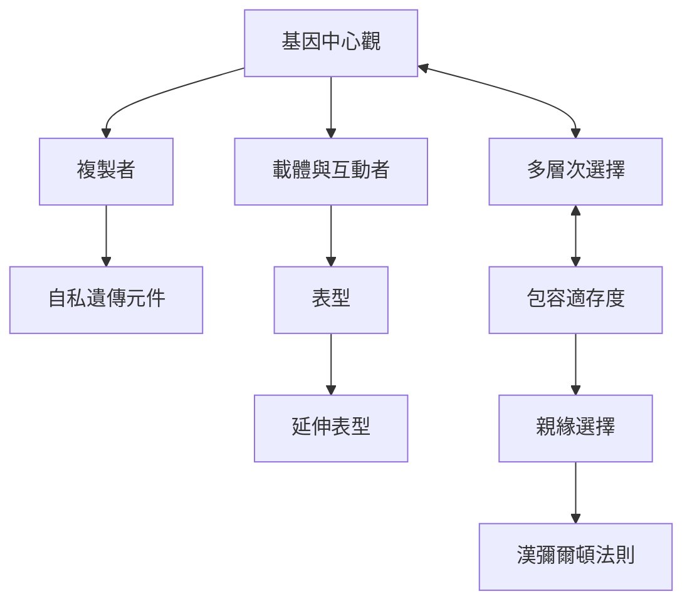

這張地圖由基因視角的基本角色出發，連接複製者、互動者、表型與自然選擇層級。重點是理解基因視角如何解釋遺傳傳播，同時辨認其與多層次選擇的相互關係。

[[基因中心觀]]、[[複製者]]、[[載體與互動者]]、[[自私遺傳元件]]、[[表型]]、[[延伸表型]]、[[多層次選擇]]、[[包容適存度]]、[[親緣選擇]]、[[漢彌爾頓法則]]互相補充：前半組說明遺傳資訊與承載者，後半組說明社會行為及選擇層級。
