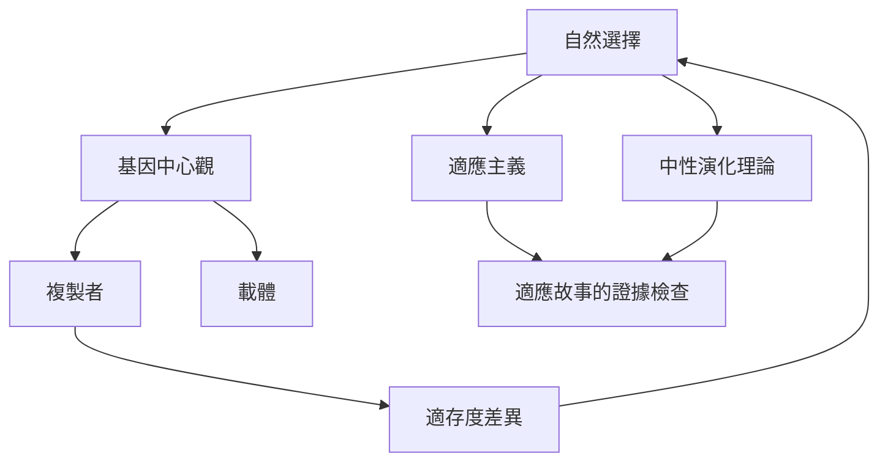

這張地圖聚焦《自私的基因》的主軸：基因中心觀如何將複製者、載體、自然選擇與適存度連起來；同時保留中性演化與適應主義批評作為檢查點。此圖不是唯一演化理論的全貌，而是閱讀原著的概念入口。

核心概念：[[基因中心觀]]、[[自然選擇]]、[[複製者]]、[[載體]]、[[適存度]]、[[表型]]、[[中性演化理論]]、[[適應主義]]。

永久筆記：[[基因的自私是比喻而非心理狀態]]、[[基因中心觀是一種演化解釋視角而非基因決定論]]、[[複製者與載體是不同層次的演化角色]]、[[基因作用必須放回細胞與生理網絡理解]]、[[適應故事必須排除替代解釋才有說服力]]。

靈感筆記：[[把自私基因改寫成複製成功能減少擬人化誤讀]]、[[以雙欄閱讀法比較自私基因與生命系統觀]]、[[用多層次因果圖取代單一基因解釋]]。

文獻筆記：[[《自私的基因》以基因視角重述自然選擇，但不是基因決定論]]、[[Williams 主張適應解釋必須嚴格並以基因選擇作為清楚起點]]、[[Gould 與 Lewontin 警告研究者不要把每個性狀都講成適應]]、[[Kimura 的中性理論提醒分子演化不必然都是適應結果]]、[[Comfort 在 2026 年回顧指出單一基因視角不足以涵蓋生命複雜性]]。
