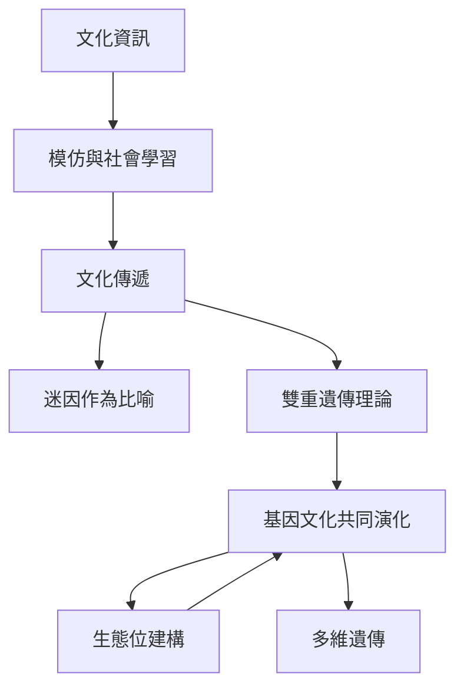

這張地圖聚焦文化資訊如何傳播、變異與穩定，以及文化如何與基因演化和環境改造互相影響。迷因是啟發式概念；雙重遺傳與基因文化共同演化提供更明確的傳遞模型。

核心概念：[[迷因]]、[[基因文化共同演化]]、[[多維遺傳]]、[[生態位建構]]、[[自然選擇]]、[[複製者]]。

永久筆記：[[迷因是文化複製的啟發式概念但不等同基因]]、[[基因文化共同演化讓文化與生物演化互相塑造]]、[[文化可以改造選擇壓力而不只是被選擇的結果]]、[[多維遺傳把基因之外的跨代傳遞納入演化分析]]。

靈感筆記：[[把迷因模型拿來研究知識傳播但先定義可觀察單位]]、[[從生態位建構重新思考日常生活如何塑造環境]]。

文獻筆記：[[Boyd 與 Richerson 建立基因與文化雙重遺傳的分析架構]]、[[Jablonka 與 Lamb 提出遺傳不只透過 DNA 序列傳遞]]、[[Laland 等人把生物改造環境視為演化因果的一部分]]。
