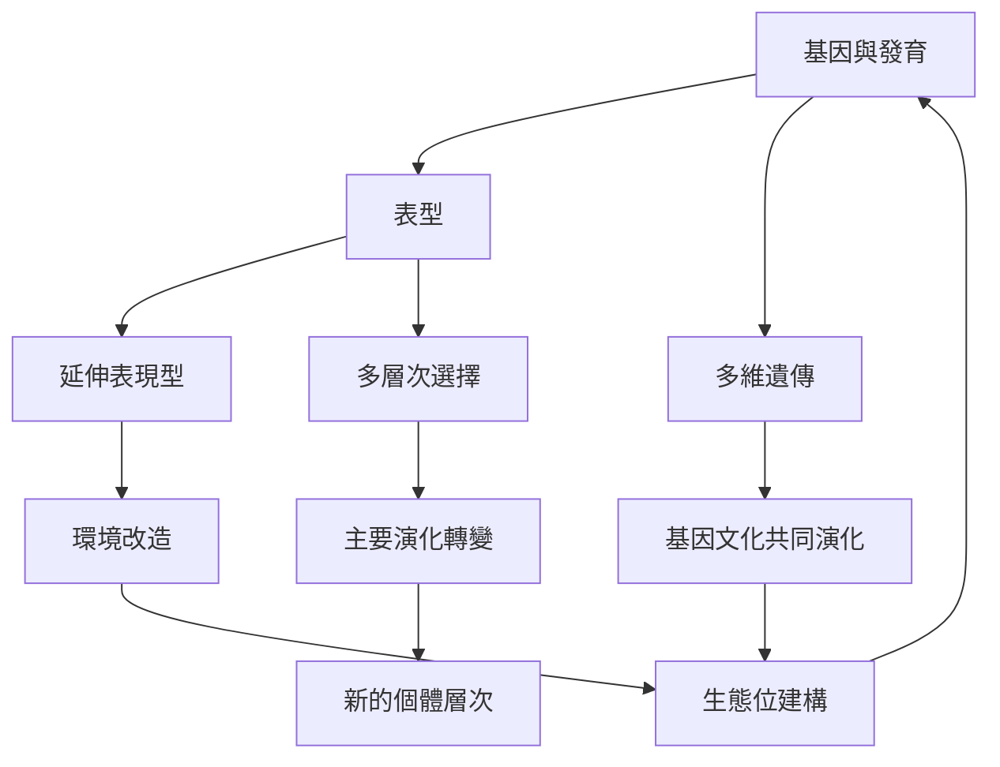

這張地圖把基因中心觀放進更廣的生命系統脈絡：表型是基因與發育環境互動的結果；延伸表現型及生態位建構強調環境回饋；多維遺傳與主要演化轉變則擴展遺傳與個體層次的想像。

核心概念：[[表型]]、[[延伸表現型]]、[[生態位建構]]、[[多維遺傳]]、[[基因文化共同演化]]、[[多層次選擇]]、[[主要演化轉變]]、[[合作]]。

永久筆記：[[延伸表現型讓基因效應不再被皮膚邊界限制]]、[[生態位建構把生物改造環境納入演化因果]]、[[基因作用必須放回細胞與生理網絡理解]]、[[多維遺傳把基因之外的跨代傳遞納入演化分析]]、[[基因文化共同演化讓文化與生物演化互相塑造]]、[[文化可以改造選擇壓力而不只是被選擇的結果]]、[[主要演化轉變把合作單位重新組織成更高層次個體]]、[[多層次選擇讓不同層級的選擇效應可以被比較]]。

靈感筆記：[[從生態位建構重新思考日常生活如何塑造環境]]、[[用多層次因果圖取代單一基因解釋]]。

文獻筆記：[[Dawkins 的延伸表現型把基因效應的分析範圍推到身體之外]]、[[Laland 等人把生物改造環境視為演化因果的一部分]]、[[Jablonka 與 Lamb 提出遺傳不只透過 DNA 序列傳遞]]、[[Noble 指出基因功能必須放回生理網絡與互動關係理解]]。
