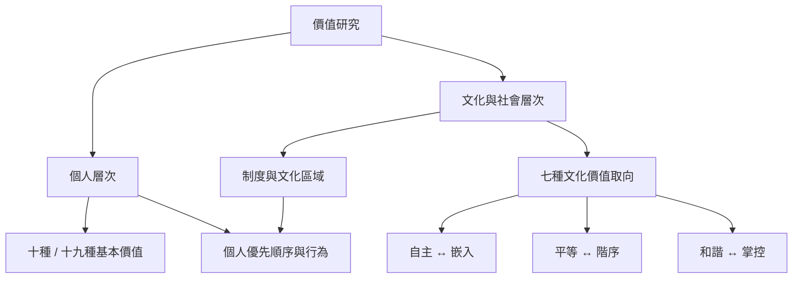

個人價值回答「個人重視什麼」，文化價值取向回答「社會制度與共享規範鼓勵什麼」。兩者互相關聯，但分析單位與測量方式不同。

核心筆記：[[個人價值與文化價值必須分開分析]]、[[七種文化價值取向回應所有社會都要處理的三類問題]]、[[文化價值取向是社會理想而不是每個人的實際行為]]、[[文化脈絡會透過制度形塑個人價值的發展]]。

文獻入口：[[七十五國資料建立文化價值取向與世界文化區域圖]]、[[三十二個歐洲國家顯示制度脈絡改變人口類別與價值的關係]]、[[西南中國少數民族研究支持細分理論但呈現文化調節]]。

概念：[[個人價值]]、[[文化價值取向]]、[[智識自主]]、[[情感自主]]、[[嵌入]]、[[平等主義]]、[[階序]]、[[和諧]]、[[掌控]]、[[生態謬誤]]。

本書導讀：[[Theory_of_basic_human_values]]
