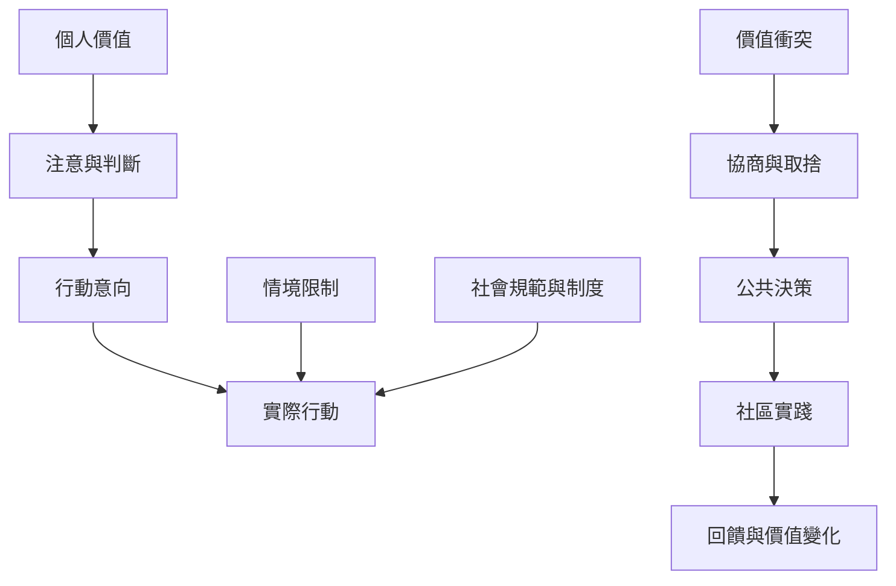

價值能影響行動，但實踐需要制度、資源與社會條件。這張地圖把個人動機連到公共決策、照顧、環境與教育。

核心筆記：[[價值能預測行動但不能單獨決定行動]]、[[價值對話應從彼此追求的目標而非標籤開始]]、[[理論的描述性普遍性不等於規範上的道德正當性]]。

靈感入口：[[讓價值圓環成為社區衝突的共同對話地圖]]、[[用價值取捨表讓團隊決策看見被犧牲的目標]]、[[把仁愛與普世主義的連結轉化為由近及遠的照顧實踐]]、[[以價值與條件雙軌設計親環境行動]]、[[建立不以量表分數取代生活敘事的價值日誌]]、[[以參與式研究共同翻譯台灣社區的價值語彙]]。

概念：[[價值與行為]]、[[情境限制]]、[[制度條件]]、[[社會規範]]、[[價值對話]]、[[參與式研究]]、[[照顧倫理]]、[[環境行為]]。

本書導讀：[[Theory_of_basic_human_values]]
