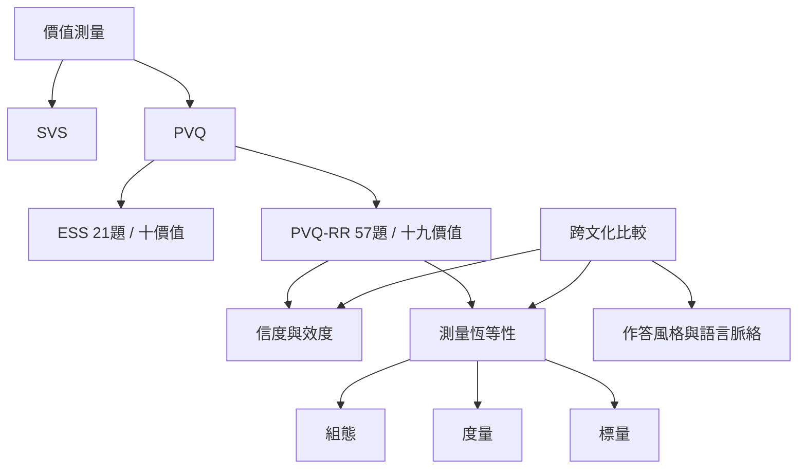

本概念地圖整理理論如何被操作化，以及跨文化測量的可靠程度。不同量表測量層級不同；跨文化結構可比性不等於平均數可直接比較。

核心筆記：[[價值測量應依研究目的選擇SVS PVQ或PVQ-RR]]、[[價值排序相似不代表人們擁有相同的價值]]、[[在地化價值研究需要讓參與者共同定義重要詞彙]]。

文獻入口：[[肖像價值問卷降低抽象價值題目的理解門檻]]、[[歐洲社會調查以二十一題測量十種基本價值]]、[[PVQ-RR在四十九個文化群體呈現穩健價值圓環]]、[[跨文化比較必須處理作答風格與測量恆等性]]、[[南非義大利與烏干達樣本支持肖像價值問卷的跨文化效度]]。

概念：[[肖像價值問卷]]、[[Schwartz價值調查]]、[[PVQ-RR]]、[[測量恆等性]]、[[作答風格]]、[[跨文化普遍性]]、[[跨文化測量]]。

本書導讀：[[Theory_of_basic_human_values]]
