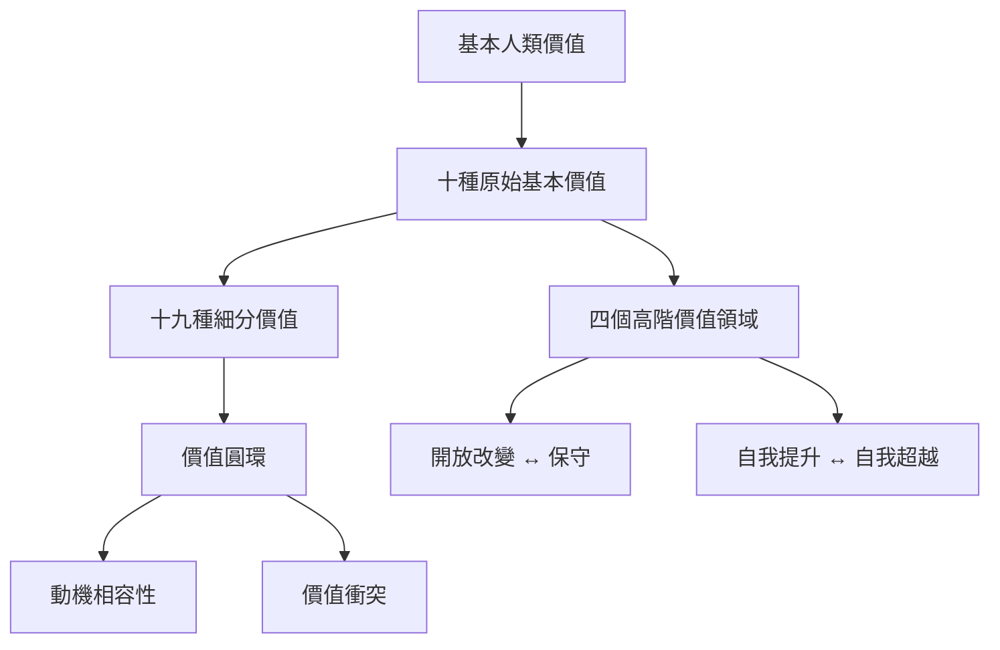

Schwartz 的理論從基本價值的動機目標出發，將十種原始價值與十九種細分價值組織成圓環。閱讀時先掌握概念定義，再理解高階價值領域、相鄰相容與對立衝突。

核心筆記：[[基本人類價值是跨情境的動機目標]]、[[價值理論從普遍的人類需求推導基本動機]]、[[價值圓環描述動機相容性而不是人格類型]]、[[十種原始基本價值可歸納為四個高階領域]]、[[十九種細分價值讓相近動機可以被分辨]]。

概念：[[基本人類價值]]、[[價值圓環]]、[[十種原始基本價值]]、[[十九種細分價值]]、[[價值優先順序]]、[[動機相容性]]、[[價值衝突]]、[[價值取捨]]、[[開放改變]]、[[自我提升]]、[[保守]]、[[自我超越]]。

文獻入口：[[十種價值構成可跨文化研究的動機分類]]、[[價值圓環同時呈現相容與衝突]]、[[十九種細分價值提升基本價值理論的解釋精度]]。

靈感入口：[[讓價值圓環成為社區衝突的共同對話地圖]]、[[用價值取捨表讓團隊決策看見被犧牲的目標]]。

本書導讀：[[Theory_of_basic_human_values]]
