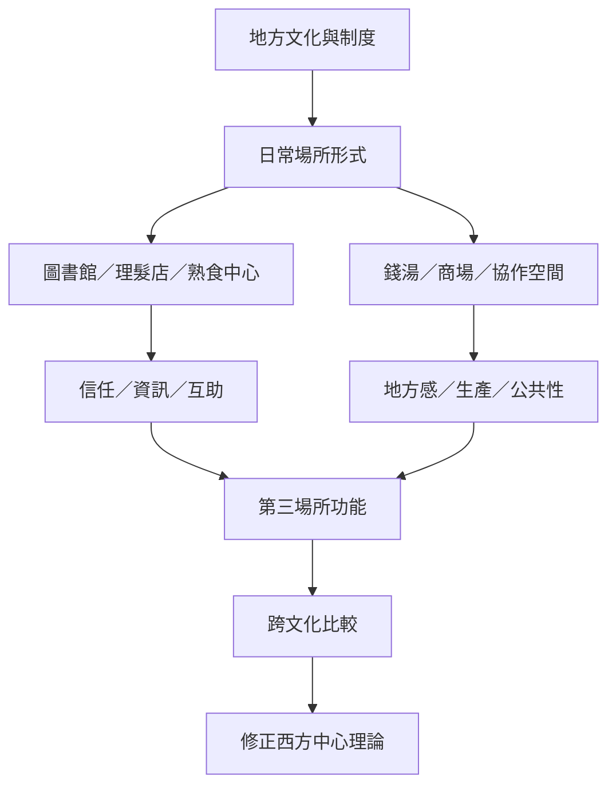

第三場所的社會功能會在不同文化中呈現不同形式。台灣圖書館、日本錢湯、新加坡熟食中心、香港商場、法國 tiers-lieux、拉丁美洲協作空間與美國黑人社區理髮店，都顯示地方歷史、制度與日常文化會重新塑造場所。跨國比較的任務不是尋找單一標準，而是辨識共通功能與地方差異。

## 概念關係圖

## 延伸閱讀
* [[note/地方性文化機構可能比標準化咖啡館更能承載社區信任]]
* [[note/第三場所概念必須接受地方文化與公共性差異的修正]]
* [[data/台灣公共圖書館能形成低強度會面並支持社會資本]]
* [[data/日本錢湯可以成為共同敘事與參與式社區設計的場域]]
* [[data/新加坡熟食中心把日常用餐轉化為多元社會的共同生活]]
* [[data/香港商場既是日常社交場域也是受到私人權力管理的空間]]
* [[data/拉丁美洲協作空間要求第三場所理論去殖民化]]
* [[term/地方感]]
* [[term/公共性]]
* 互見：[[data/法國第三場所運動把共享工作與地方協作納入空間生態]]
* 互見：[[data/非西方城市的公共性必須從地方實踐理解]]
* 返回導讀：[[Third_place]]
