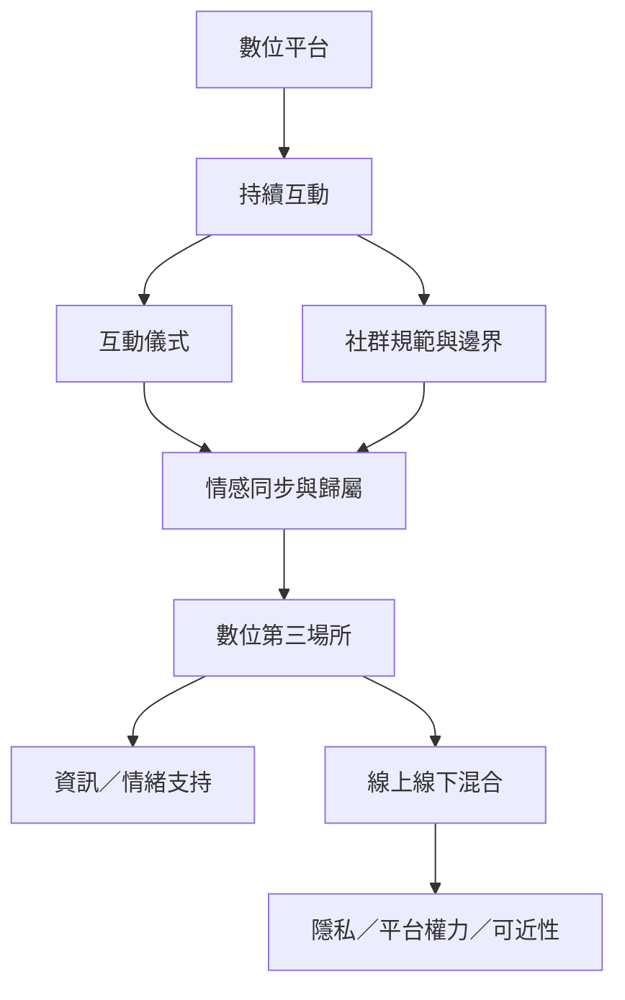

數位第三場所不只是把實體店面搬到線上，而是透過持續互動、社群規範、互動儀式與情感同步形成歸屬與支持。線上與實體可以互補，也可能帶來平台治理、資料監控、騷擾與數位落差等新問題。

## 概念關係圖

## 延伸閱讀
* [[note/數位第三場所依靠持續互動與社群規範形成]]
* [[data/日本遊戲玩家的Discord社群能逐漸形成數位第三場所]]
* [[data/數位第三場所透過互動儀式而不是單純平台功能形成]]
* [[data/不穩定工作者透過實體與虛擬第三場所交換照護與資源]]
* [[idea/建立線上社群與實體聚會之間可自由往返的橋梁]]
* [[term/數位社群]]
* [[term/共同治理]]
* 返回導讀：[[Third_place]]
