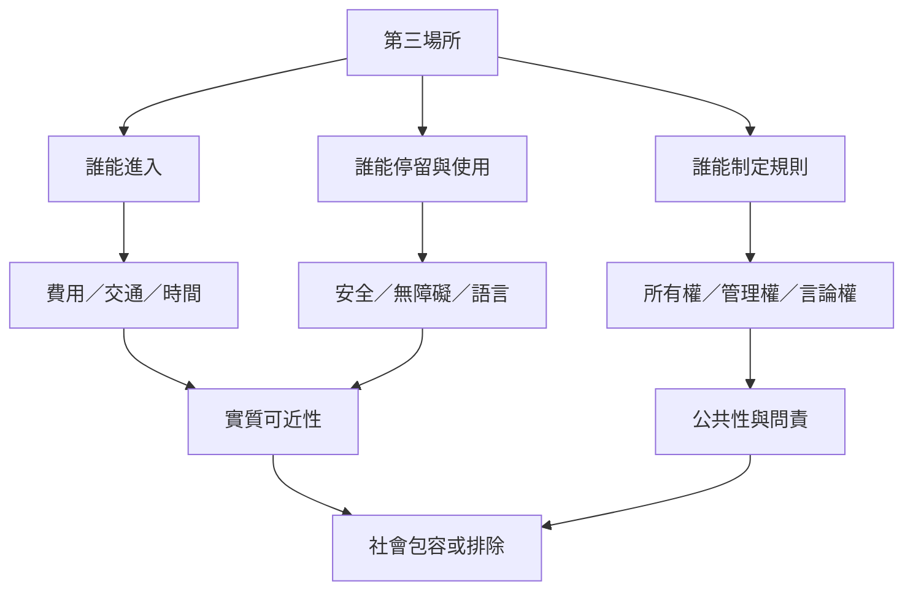

開放入口不等於平等使用。這張地圖把所有權、費用、性別安全、無障礙、管理規則與公共表達權連起來，協助辨識哪些人容易進入，哪些人只能短暫停留，哪些人會被排除。公共性應從實際權利與經驗衡量，而非只看空間外觀。

## 概念關係圖

## 延伸閱讀
* [[note/第三場所的開放性必須接受性別與身體經驗的檢驗]]
* [[note/第三場所的安全感來自關係與治理而不只是地點]]
* [[note/第三場所不等於公共空間或公共領域]]
* [[idea/用空間正義清單檢查誰被排除在第三場所之外]]
* [[term/社會包容]]
* [[term/城市權]]
* [[term/公共領域]]
* 互見：[[data/女性使用第三場所時仍需協商性別化的安全與自由]]
* 返回導讀：[[Third_place]]
