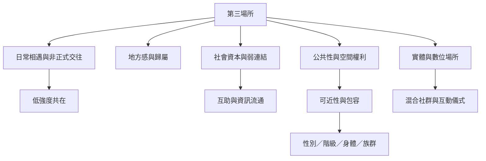

第三場所研究的核心問題，是人們如何在家與工作之外，透過日常相遇形成歸屬、弱連結、互助與公共生活。這張地圖把定義、社會結果、地方實踐、數位轉型與空間正義連接起來。第三場所不是一種建築用途，也不必然平等；它需要以使用者經驗和制度脈絡來判斷。

## 概念關係圖

## 延伸閱讀
* [[note/第三場所是一種社會功能而不是固定建築類型]]
* [[note/第三場所不等於公共空間或公共領域]]
* [[note/第三場所的價值在於讓弱連結有機會累積]]
* [[note/第三場所可以提供低強度共在而不必強迫交談]]
* [[note/第三場所的開放性必須同時容納熟悉感與新來者]]
* [[idea/用十五分鐘步行圈檢查社區是否真的擁有第三場所]]
* [[term/第三場所]]
* [[term/地方感]]
* [[term/社會資本]]
* [[term/公共空間]]
* 互見：[[data/第三場所把家庭與工作之外的日常聚會視為社區生活的錨點]]
* 返回導讀：[[Third_place]]
