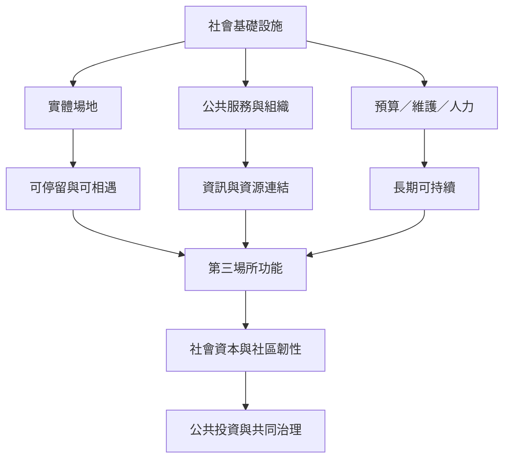

這張地圖聚焦場所如何被建造、資助、維護與治理。第三場所提供相遇機會，社會基礎設施則提醒我們把人力、預算、公共服務、交通、規範與組織放進分析。場域能否長期支持公共生活，取決於制度如何分配進入權、成本與決策權。

## 概念關係圖

## 延伸閱讀
* [[note/社會基礎設施不只是建築而是維護關係的制度組合]]
* [[note/公共圖書館的第三場所功能取決於使用規範與服務設計]]
* [[note/第三場所的經濟模式必須兼顧可負擔與維持生計]]
* [[note/第三場所的成效不能只用人流或消費額衡量]]
* [[idea/第三場所的治理應讓使用者共同制定規則與分配資源]]
* [[term/社會基礎設施]]
* [[term/共同治理]]
* [[term/共同資源]]
* 互見：[[data/社會基礎設施讓偶然相遇成為可持續的公共生活]]
* 返回導讀：[[Third_place]]
