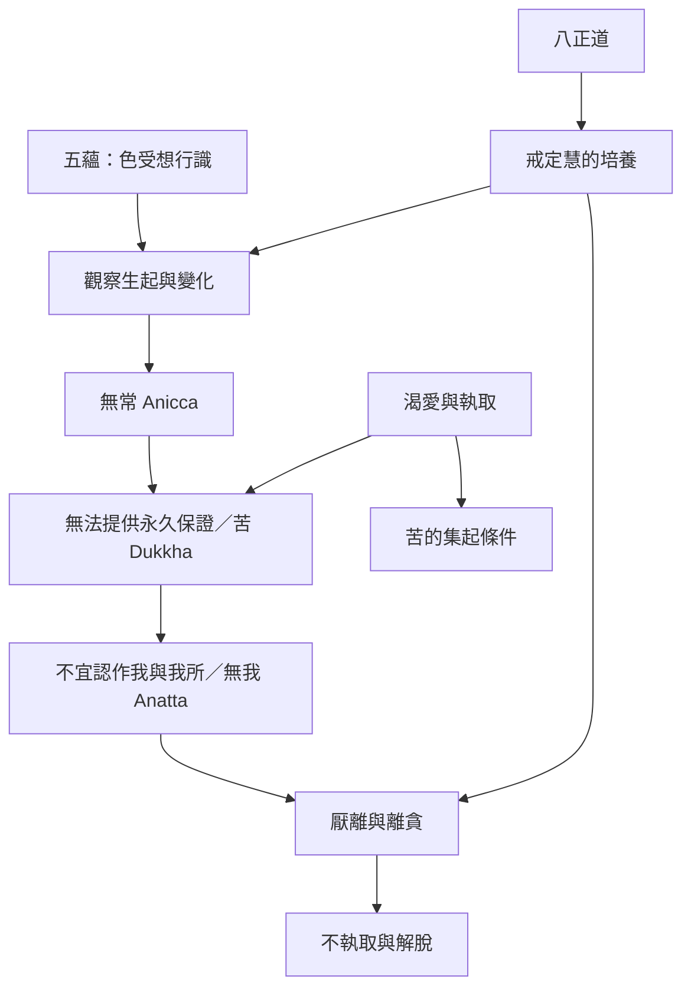

這張圖把早期經典中對五蘊的觀察、三相的互相照明，以及修行的轉化方向放在同一張圖中。箭頭表示教學上常見的觀察關係，不應一概理解為嚴格的形式邏輯演繹。

### 相關概念
[[Anicca]]、[[Dukkha]]、[[Anatta]]、[[Pañcupādānakkhandhā]]、[[Vedanā]]、[[Taṇhā]]、[[Upādāna]]、[[Four_Noble_Truths]]。

### 相關筆記
[[三相是相互照明而不是三個孤立命題]]、[[五蘊不是固定自我的容器而是持續變化的經驗過程]]、[[不能完全支配的經驗不適合被執取為我]]。
