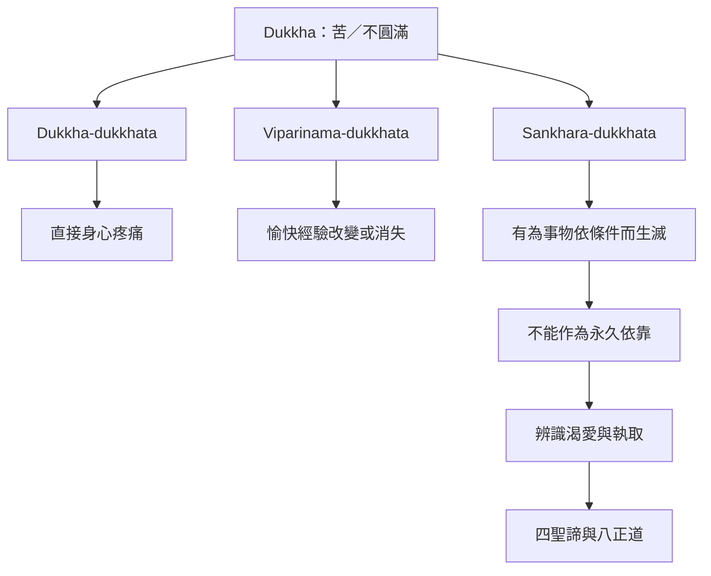

苦不是單一的疼痛感受。SN 45.165 列出三種苦的形式，協助區分直接疼痛、愉快經驗的變易，以及一切有為條件的脆弱性。

### 相關概念
[[Dukkha]]、[[Anicca]]、[[Vedanā]]、[[Taṇhā]]、[[Upādāna]]、[[Four_Noble_Truths]]。

### 相關筆記
[[苦指向無法徹底滿足與掌控的條件性]]、[[三種苦說明快樂也可能因變易而不可靠]]、[[追蹤感受如何轉成渴愛與執取可以看見苦的條件]]。
