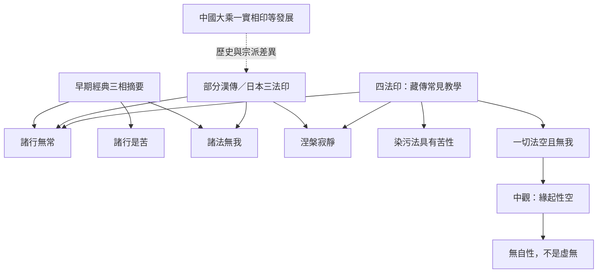

不同佛教傳統使用相近但不完全相同的分類。此圖是比較用的定位，不代表各宗派內部沒有其他版本或詮釋分歧。

### 相關概念
[[Tilakkhaṇa]]、[[Three_Dharma_Seals]]、[[Four_Dharma_Seals]]、[[Anicca]]、[[Dukkha]]、[[Anatta]]、[[Suññatā]]、[[Paṭiccasamuppāda]]。

### 相關筆記
[[三法印四法印與三相是相關但不完全相同的分類]]、[[不同傳統的分類應先比較範圍再比較內容]]、[[空性不是虛無而是缺乏獨立自性]]。
