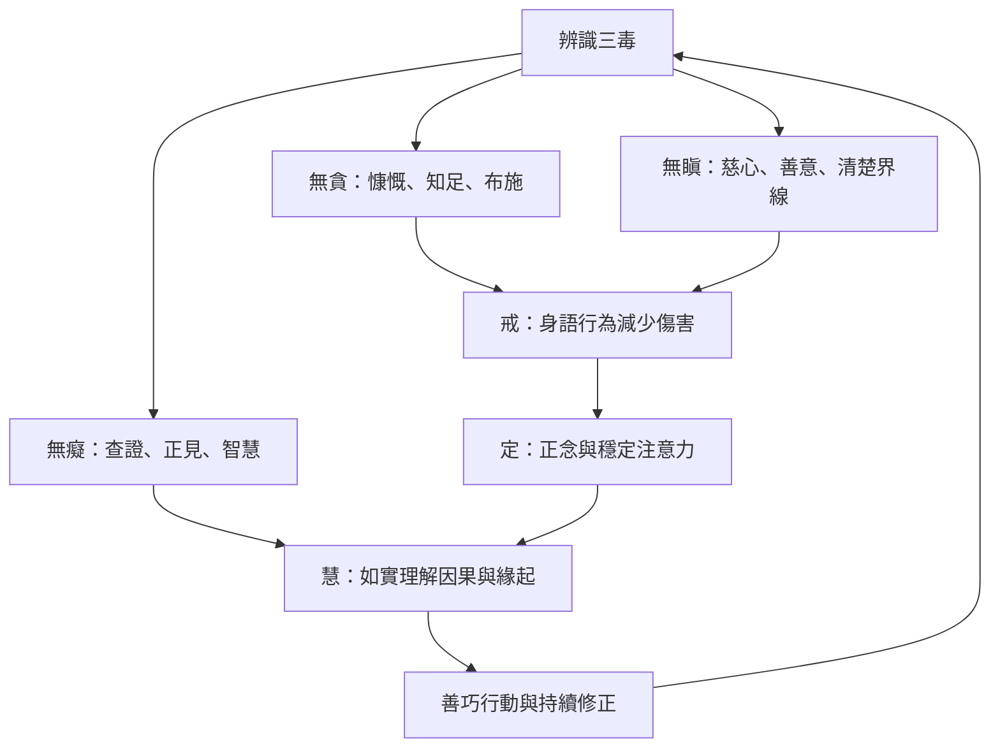

三毒的對治不以壓抑情緒為目標，而是培養三種能替代慣性反應的善根，並透過戒、定、慧整合到日常生活。下圖是一張實踐路徑圖，可依個人情境選取入口。

## 相關筆記
* [[三善根以慷慨慈心與智慧作為正向對治]]、[[三善根提供的是替代能力而不是情緒壓抑]]。
* [[正語正業正命讓內在修行落實於關係與制度]]、[[慈悲不等於縱容傷害而是以不傷害的方式回應]]、[[無常無我與緣起觀能鬆動三毒的認知基礎]]。

## 概念詞條
[[無貪]] [[無瞋]] [[無癡]] [[布施]] [[慈心]] [[慧]] [[八正道]] [[四聖諦]]
