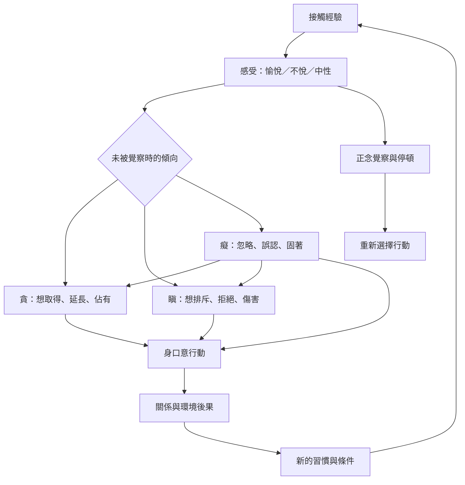

這張地圖將三毒理解為經驗處理中的三種傾向：抓取、推拒與誤認。三者可互相增強，並透過身、語、意行為形成後果。圖中的流程是教學用的概念模型，不宣稱所有心理事件都必然按單一路徑發生。

## 相關筆記
* [[貪不是所有欲望而是把滿足視為必需的攫取]]、[[瞋不只是生氣而是排斥與傷害意向的強化]]、[[癡不等於知識不足而是對經驗與自我的誤認]]。
* [[無明會讓貪與瞋看似合理且必要]]、[[三毒互相強化會形成重複的苦循環]]、[[覺察感受能在觸受與渴愛間打開行動空間]]。

## 概念詞條
[[感受]] [[渴愛]] [[執取]] [[無明]] [[緣起]] [[三毒]]
