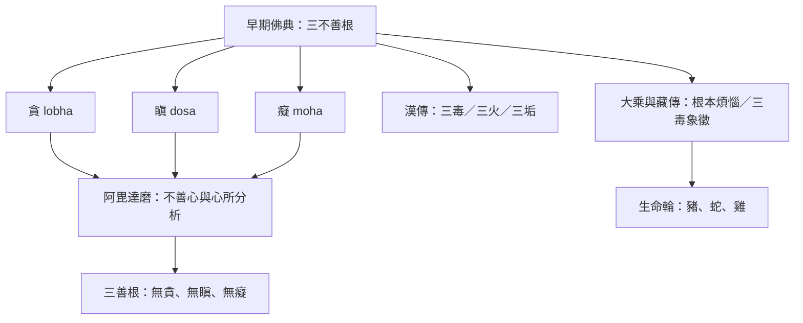

這張地圖整理三毒概念從早期經典的三不善根，延伸到阿毘達磨的心理分析、漢傳論典的三毒詮釋，以及大乘與藏傳生命輪的象徵系統。閱讀時需留意：相同的「貪瞋癡」詞組，在不同語言、文本與修行傳統中有各自的術語背景。

## 相關筆記
* 早期經典與漢譯：[[早期佛典把貪瞋癡列為三種不善根]]、[[伊提弗陀迦經指出三毒會像竹叢自毀般反噬行為者]]、[[雜阿含經以調伏貪瞋癡衡量正法的實際效用]]、[[漢傳佛教辭典將貪瞋癡總攝為三毒與三不善根]]。
* 心理分類與大乘理論：[[阿毘達磨以心所分析貪瞋癡如何構成不善心]]、[[唯識學以染污意解析自我執取如何延續煩惱]]、[[三毒與六根本煩惱屬於不同的分類尺度]]。
* 圖像與詮釋：[[藏傳生命輪以豬蛇雞象徵三毒的循環增幅]]、[[生命輪圖像在不同地域與譯本間並非完全一致]]、[[三毒的術語史必須區分經典與後代詮釋]]。

## 概念詞條
[[三毒]] [[貪]] [[瞋]] [[癡]] [[煩惱]] [[阿毘達磨]] [[輪迴]]
