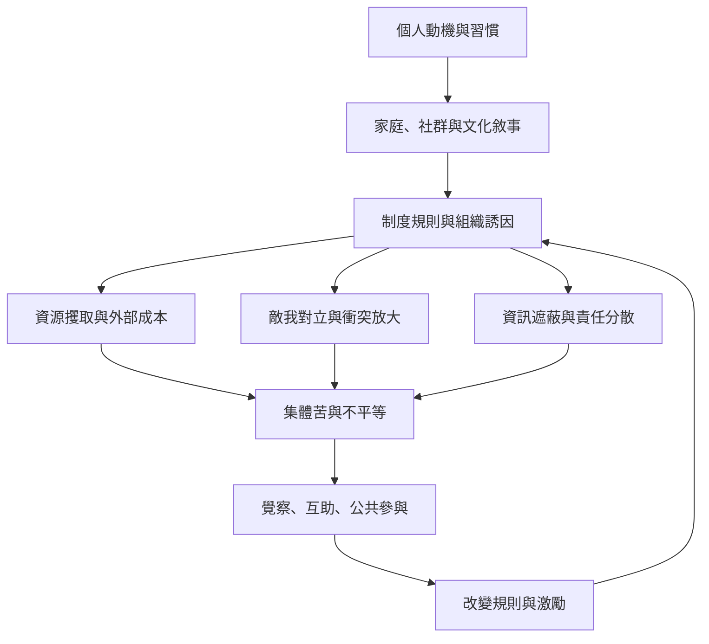

三毒的社會分析不是把制度當成真的有情緒，而是辨認制度如何獎勵攫取、放大敵意或遮蔽資訊。個人修行與結構改革需要互相校正：只責備個人會忽略制度；只批判制度也可能忽略個人如何參與其再製。

## 相關筆記
* [[大衛洛伊提出三毒可能被制度化為集體性苦難]]、[[參與式佛教研究把個人煩惱延伸至社會制度改革]]、[[舒馬赫的佛教經濟學以正命與簡樸反思消費主義]]。
* [[制度也會把貪瞋癡固化為日常誘因]]、[[分享與共用能把無貪轉化為可見的生活制度]]、[[正語正業正命讓內在修行落實於關係與制度]]。

## 概念詞條
[[三毒]] [[布施]] [[慈心]] [[八正道]] [[輪迴]]
