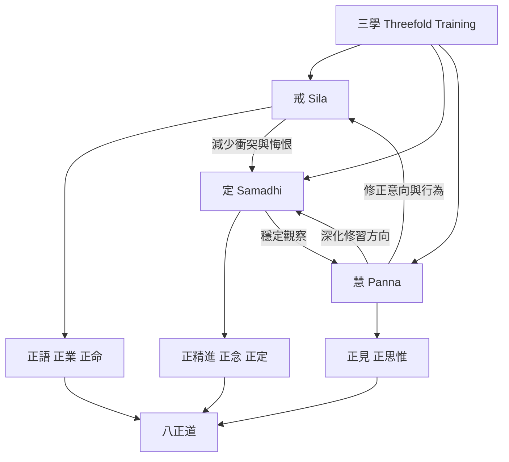

三學是佛教修道的整體地圖：戒建立不害與自律的生活條件，定培育穩定清明的心，慧以如實知見鬆動無明。八正道把三學展開為八項實踐；聞思修則呈現智慧如何由學習走向體證。三學不是三個互不相干的課程，而是有不同功能、彼此回饋的修習系統。

## 雙向連結
- [[note/三學以戒定慧統攝整體修道而非三門互不相干的課程]]
- [[note/八正道是三學在行為心智與見地上的具體展開]]
- [[note/三學互相滋養而非固定的單向階梯]]
- [[note/定慧雙修指出穩定心與洞察力需要同步發展]]
- [[term/三學是戒定慧三種相互依存的修道訓練]]
- [[term/八正道把修行分成八個互相支援的實踐因素]]
