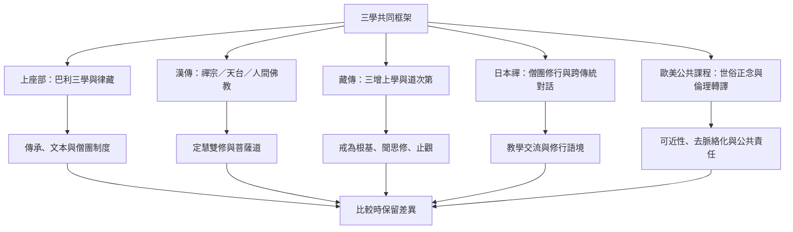

三學具有跨區域的連結力，但不同佛教傳統在律系、修行方法、菩薩道、教學次第與社會制度上各有特色。上座部可從巴利三學與律藏教育理解；漢傳禪宗、天台在人間佛教脈絡下談定慧雙修與實修；藏傳常把三增上學放入道次第與聞思修；日本曹洞與藏傳教師的對話呈現跨傳統交流；歐美正念課程則顯示宗教實踐轉譯為公共課程時的選擇與張力。

## 雙向連結
- [[note/三學能成為跨宗派對話的共同語言但不能抹平傳統差異]]
- [[note/漢傳禪宗與天台以定慧雙修回應三學偏廢的問題]]
- [[note/藏傳道次第把戒視為定慧根基並以慧斷除煩惱根本]]
- [[note/世俗正念若抽離倫理與解脫脈絡便會改變其意義]]
- [[note/三學的公共轉譯必須誠實交代保留與省略了什麼]]
- [[data/林佩瑩研究星雲大師實修觀呈現漢傳禪宗與天台的三學整合]]
- [[data/英國佛教團體訪談研究顯示世俗正念課程在傳承與公共服務間協商]]
